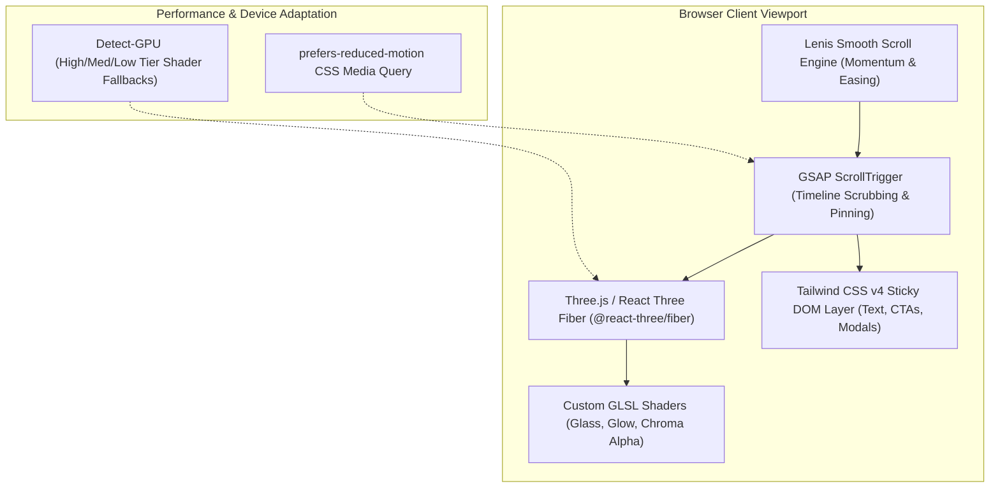

# VDO Studio — 3D Scroll Promotional Website Architecture & Master Specification

> **A Complete Blueprint for Building an Award-Winning (Awwwards / FWA / Apple-Grade), 3D Scroll-Driven Marketing & Conversion Website for VDO Studio.**
>
> *Designed to mesmerize visitors, elaborate on VDO Studio's groundbreaking features, demonstrate real-time capabilities, and convert creators into active users through high-converting offers, login/signup funnels, and interactive product labs.*

---

## 📑 Table of Contents

1. [Executive Concept & Creative Direction](#1-executive-concept--creative-direction)
2. [Target Audience & Psychological Conversion Funnel](#2-target-audience--psychological-conversion-funnel)
3. [Technology Architecture & Performance Stack](#3-technology-architecture--performance-stack)
4. [Master 15-Chapter 3D Scroll Storytelling Flow](#4-master-15-chapter-3d-scroll-storytelling-flow)
5. [Deep Feature Showcase & Interactive Demonstrations](#5-deep-feature-showcase--interactive-demonstrations)
6. [Interactive In-Browser Player Lab Section](#6-interactive-in-browser-player-lab-section)
7. [User Onboarding, Offers & High-Converting Auth Funnel](#7-user-onboarding-offers--high-converting-auth-funnel)
8. [Component Hierarchy & Implementation Roadmap](#8-component-hierarchy--implementation-roadmap)
9. [Visual Design System, Shaders & Lighting Guide](#9-visual-design-system-shaders--lighting-guide)
10. [NotebookLM & Pitch Presentation Prompts](#10-notebooklm--pitch-presentation-prompts)

---

## 1. Executive Concept & Creative Direction

### 1.1 The Core Thesis
Most SaaS landing pages fail because they are passive walls of text with static feature screenshots. 
**VDO Studio's promotional website is not a webpage — it is an interactive cinematic experience.**

> **"Don't just read about the future of video. Scroll through it."**

The website adopts the design language of **Apple product launches**, **Linear's sleek dark aesthetics**, and **Awwwards-winning WebGL interactive sites** (such as Active Theory and Locomotive).

```
VISITOR OPENS SITE
       │
       ▼
[01: Cinematic 3D Hero]  ─── Floating 3D VDO Player with glowing glass layers
       │
       ▼ (User Scrolls)
[02: The Exploded Rig]   ─── Player unrolls into 3D multi-track timeline ribbons
       │
       ▼ (User Scrolls)
[03: Alpha Avatar Magic] ─── 3D character steps OUT of the video box directly onto the webpage
       │
       ▼ (User Scrolls)
[04: Smart Audio Duck]   ─── Real-time 3D sound waves visually duck during speech
       │
       ▼ (User Scrolls)
[05: Motion Tracking]    ─── 3D camera tracks a moving subject with perspective HUDs
       │
       ▼ (User Scrolls)
[06: Precision Trimming] ─── Real-time thumbnail scrubbing & auto 0:00 alignment
       │
       ▼ (User Scrolls)
[07: Interactive Lab]    ─── User clicks toggles on an actual live VDO player
       │
       ▼ (User Scrolls)
[08: The Privacy Vault]  ─── 100% Local Apple VideoToolbox speed vs slow cloud uploads
       │
       ▼ (User Scrolls)
[09: Exclusive Offers]   ─── Launch pricing, Pro perks & 1-click Sign In
       │
       ▼
[10: Instant Studio Launch] ── Camera dives into the player screen ➔ Direct entry into VDO Studio!
```

### 1.2 Core Creative Principles
1. **No Animation Without a Purpose**: Every 3D camera move, rotation, and particle effect directly demonstrates a real feature of VDO Studio.
2. **The "Player as the Hero" Motif**: The 3D VDO Player is the central visual protagonist throughout the entire scroll journey. It morphs, transforms, rotates, expands into timelines, and reveals features as the user scrolls.
3. **Tactile Interaction**: Users don't just watch — they can hover, click, rotate in 3D, and interact with live controls directly in their browser.
4. **Frictionless Onboarding**: High-visibility CTAs (`Launch Studio Free`, `Sign Up with Google`, `Claim Pro Creator Pass`) appear at psychological peak moments throughout the scroll journey.

---

## 2. Target Audience & Psychological Conversion Funnel

The website is engineered around a 5-stage psychological discovery journey:

```text
Discovery Phase   ──►  "Wow, this interface looks incredibly sleek and futuristic."
Intrigue Phase    ──►  "Wait... did that character just step out of the video without a box?"
Realization Phase ──►  "Automatic speech ducking? Duration-bounded motion tracking? In the browser?!"
Validation Phase  ──►  "And my 4K video files never leave my computer? Zero cloud upload lag?"
Action Phase      ──►  "I need to try this right now. [Launch VDO Studio Free]"
```

### Targeted Personas:
1. **AI Video Creators & Generative Artists**: Using Google Veo, Runway, Midjourney, and Kling who need transparent avatar cutouts and audio mixing without mastering Premiere.
2. **Web Developers & UI/UX Designers**: Looking for copy-paste transparent video embeds for marketing sites and landing pages with zero dark fringes.
3. **Content Creators, YouTubers & Podcasters**: Who want instant silence removal, automated dialogue ducking for voiceovers, and viral 9:16 smart cropping.
4. **Corporate & Privacy-Conscious Teams**: Enterprises with strict NDA footage that cannot be uploaded to third-party cloud servers.

---

## 3. Technology Architecture & Performance Stack



### 3.1 Frontend Stack Breakdown
- **Next.js 16 (App Router)** & **React 19**: Server-side rendered static HTML shell for instant SEO indexing, hydration, and OpenGraph social previews.
- **Lenis Smooth Scroll (`@studio-freight/lenis`)**: Provides luxurious, momentum-based scrolling across trackpads, mice, and touchscreens without breaking browser native accessibility.
- **GSAP & ScrollTrigger (`gsap/ScrollTrigger`)**: Synchronizes scroll progress (`0.0` to `1.0`) with 3D camera paths, light positions, model morphs, and DOM text transitions.
- **Three.js & React Three Fiber (`@react-three/fiber`, `@react-three/drei`)**:
  - Declarative WebGL canvas rendering the 3D VDO Player rig, floating video layers, and atmospheric particles.
  - GLTF/GLB models optimized with Draco mesh compression.
- **Tailwind CSS v4**: Ultra-modern token-based styling for sticky HUD panels, frosted glass dialogs, and glowing CTA buttons.
- **Web Audio API**: Subtle, optional interactive sound feedback (soft clicks on toggles, whoosh on camera transitions with a global mute toggle).

### 3.2 Performance & Mobile Optimization Strategy
- **LOD (Level of Detail)**: High-geometry meshes and reflections on desktop GPUs; low-poly models and baked reflection maps on mobile or low-power devices.
- **Reduced Motion Fallback**: When `prefers-reduced-motion: reduce` is detected, 3D camera animations smoothly cross-fade between static viewpoints while preserving interactive UI cards.
- **Canvas Viewport Virtualization**: Renders Three.js frames only when the canvas is within the visible viewport or actively animating.

---

## 4. Master 15-Chapter 3D Scroll Storytelling Flow

```
[CHAPTER 01] Cinematic Hero (The Floating 3D Player)
      ↓
[CHAPTER 02] The Exploded Rig (Unfolding Multi-Track Timeline)
      ↓
[CHAPTER 03] Video Without The Box (Transparent Web Avatars)
      ↓
[CHAPTER 04] The Dual-Stream Breakthrough (WebM + Apple MOV Alpha)
      ↓
[CHAPTER 05] Smart Audio Mix (Dialogue Ducking in 3D Space)
      ↓
[CHAPTER 06] Computer Vision (Duration-Bounded Motion Tracking)
      ↓
[CHAPTER 07] Google Vids-Style Trimming (Live Thumbnail Scrubbing)
      ↓
[CHAPTER 08] Bidirectional Audio Detach & Attach Toggle
      ↓
[CHAPTER 09] Television Broadcast Graphics & 4K Camera HUDs
      ↓
[CHAPTER 10] Cinematic 30+ LUTs & Real-Time Color Matrix
      ↓
[CHAPTER 11] Generative AI Hub (Highlights, Silences, Voiceovers)
      ↓
[CHAPTER 12] The Interactive Player Lab (Hands-on Product Demo)
      ↓
[CHAPTER 13] The Local-First Privacy Shield (Apple VideoToolbox Speed)
      ↓
[CHAPTER 14] Creator Personas & Conversion Showcase
      ↓
[CHAPTER 15] Grand Finale & Launch Offer Funnel (Dual CTA)
```

---

### Detailed Chapter Breakdown

#### Chapter 01: The Cinematic Hero (0% – 8% Scroll)
- **Visual**: A dark, atmospheric obsidian stage (`#050505`) with a subtle volumetric spotlight. Floating in 3D space is a sleek, ultra-thin glass-and-titanium **VDO Player viewport**. Subtle animated particles float through the scene.
- **Hero Headline**:
  ```text
  VDO STUDIO
  VIDEO EDITING & PLAYBACK, REIMAGINED.
  ```
- **Subheadline**: *"The world's first local-first video workstation with real-time transparent web avatars, intelligent dialogue ducking, and hardware-accelerated rendering right in your browser."*
- **Primary CTAs**:
  - `[ Launch Studio Free ]` (High-contrast electric blue glow)
  - `[ Explore 3D Story ]` (Down arrow with smooth scroll bounce)
- **Interactive Element**: Mouse movement dynamically tilts the 3D player in 6 degrees of freedom with subtle specular reflection glares.

---

#### Chapter 02: The Exploded Rig — Unfolding Multi-Track Timeline (8% – 15% Scroll)
- **3D Animation**: As the user scrolls, the player smoothly tilts back at a 45-degree angle. Five glowing neon-glass ribbons physically unroll out of the player screen downward into a **3D multi-track timeline**:
  - Ribbon 1: *Video Main Track*
  - Ribbon 2: *Transparent Overlay Layer*
  - Ribbon 3: *Auto Captions & Subtitles*
  - Ribbon 4: *Intelligent Dialogue Audio*
  - Ribbon 5: *Broadcast Lower Thirds*
- **Copy**:
  ```text
  TRUE DESKTOP MULTI-TRACK POWER.
  INSIDE A BROWSER TAB.
  ```
- **Key Callout**: *"Vertical track reordering, instant layer dragging, track mute toggles (Eye/EyeOff), and frame-accurate playback without installing a single gigabyte of software."*

---

#### Chapter 03: Video Without The Box — Transparent Web Avatars (15% – 22% Scroll)
- **3D Animation**: The camera flies in close. A green-screen AI presenter is playing inside the video frame. Suddenly, a glowing green grid sweeps across the video: the background dissolves into a transparent checkerboard, and **the character literally steps OUT of the video frame**, floating directly above the website text!
- **Interactive Feature**: The background of the website dynamically switches behind the avatar:
  - State A: Dark developer terminal
  - State B: Vibrant e-commerce store
  - State C: Frosted glass dashboard
- **Copy**:
  ```text
  VIDEO WITHOUT THE BOX.
  ZERO DARK FRINGING. ZERO COMPROMISE.
  ```
- **Key Callout**: *"Real-time WebGL chroma keying with pixel-magnifier eyedropper, similarity thresholding, and spill suppression that eliminates green halo light from skin and hair."*

---

#### Chapter 04: The Dual-Stream Breakthrough — WebM + Apple MOV Alpha (22% – 28% Scroll)
- **3D Animation**: Two 3D metallic discs emerge from the transparent avatar:
  - Disc 1: **WebM VP9 Alpha** (Chrome, Firefox, Android)
  - Disc 2: **QuickTime MOV Apple HEVC Alpha** (Safari, iPhone, iPad)
- They orbit each other and fuse into a glowing code bracket displaying the **Copy-Paste HTML5 Embed Snippet**.
- **Copy**:
  ```text
  ONE EXPORT.
  UNIVERSAL CROSS-BROWSER TRANSPARENCY.
  ```
- **Feature Matrix**: Shows how VDO Studio eliminates browser engine fragmentation by generating both required codecs in a single render pass.

---

#### Chapter 05: Smart Audio Mix — Dialogue Ducking in 3D Space (28% – 36% Scroll)
- **3D Animation**: Two glowing neon audio waveforms float in 3D space:
  - Blue Wave: *Video Dialogue Track*
  - Magenta Wave: *Voiceover Narration Track*
- As the user scrolls, the voiceover wave spikes. The camera rotates to show the video dialogue waveform **automatically dip down with smooth trapezoidal ramps**, maintaining total clarity for both speakers.
- **Copy**:
  ```text
  INTELLIGENT DIALOGUE DUCKING.
  NO MANUAL KEYFRAMING REQUIRED.
  ```
- **3 Priority Modes Display**:
  1. **Intelligent Both**: 85% Voiceover + 60% Dialogue during speech overlaps.
  2. **Voiceover First**: Crisp narrative tutorial ducking.
  3. **Video First**: On-camera interview priority.
- **Key Metric**: *"100% Non-destructive volume keyframe automation with instant 1-click reset."*

---

#### Chapter 06: Computer Vision — Duration-Bounded Motion Tracking (36% – 44% Scroll)
- **3D Animation**: A video clip of a moving vehicle or running athlete plays. 
- A glowing target reticle locks onto the subject. User sees two slider handles set the **Tracking Range [00:02.10 ➔ 00:06.80]**.
- A 3D holographic tag (`"4K CYBER EDITION - $899"`) attaches to the moving object, realistically skewing, tilting, and rotating in perspective as the subject moves across the screen.
- **Copy**:
  ```text
  AI MOTION TRACKING.
  BOUNDED BY TIME. LOCKED IN PERSPECTIVE.
  ```
- **Key Callout**: *"Don't waste time tracking full clips. Isolate the exact range, lock text, badges, or stickers, and let MediaPipe calculate homography perspective matrices automatically."*

---

#### Chapter 07: Google Vids-Style Starting Clip Trimming (44% – 50% Scroll)
- **3D Animation**: A timeline clip appears with glowing trim handles. An animated cursor drags the left trim handle. 
- As the handle moves, **a live floating filmstrip thumbnail updates in real-time** showing the exact video frame under the cut, while the timeline automatically shifts to 0:00 without creating dead gaps.
- **Copy**:
  ```text
  SURGICAL PRECISION TRIMMING.
  FRAME-ACCURATE SCRUBBING.
  ```

---

#### Chapter 08: Bidirectional Detach & Attach Audio Toggle (50% – 56% Scroll)
- **3D Animation**: The timeline audio button pulses.
  - *Click 1*: Audio waveform pulls downward onto an audio track; video displays a sleek muted indicator; button switches to active glowing blue: **"Attach"**.
  - *Click 2*: Audio waveform snaps back into the video clip; empty audio track vanishes; button returns to **"Detach"**.
- **Copy**:
  ```text
  DETACH. EDIT. RE-ATTACH.
  A TRUE BIDIRECTIONAL TOGGLE.
  ```
- **Key Callout**: *"Never lose your audio links. Make precision waveform cuts, then snap audio back into your video container with preserved volume and fades."*

---

#### Chapter 09: Broadcast News Graphics & 4K Camera HUDs (56% – 64% Scroll)
- **3D Animation**: The 3D player transforms into a live television studio monitor.
  - A glowing lower third animates onto the screen with custom brand colors.
  - A breaking news alert ticker crawls smoothly across the bottom.
  - An authentic 4K cinema camera viewfinder HUD snaps into place: blinking red `[REC]` dot, ISO readouts, rule-of-thirds grid, and live timecode counter.
- **Copy**:
  ```text
  TELEVISION BROADCAST GRAPHICS.
  BUILT-IN CINEMA HUDS.
  ```
- **Interactive Element**: Visitors can click 4 preview tabs (`Breaking News`, `Lower Third`, `Camera HUD`, `Viral Meme`) to switch graphics live.

---

#### Chapter 10: Cinematic 30+ Studio LUTs & Real-Time Color Matrix (64% – 70% Scroll)
- **3D Animation**: An interactive before/after split slider glides across the 3D player screen.
  - Left: *Flat Log Camera Footage*
  - Right: *Hollywood Cinema Teal & Orange (Grade A LUT)*
- **Copy**:
  ```text
  HOLLYWOOD COLOR SCIENCE.
  REAL-TIME GPU SHADER PREVIEW.
  ```
- Shows 5 quick preset badges: *Film Noir*, *Vintage 70s*, *Cyberpunk Neon*, *Documentary Crisp*, *Clean Golden Hour*.

---

#### Chapter 11: Generative AI Automation Hub (70% – 76% Scroll)
- **3D Animation**: Four floating glass cards orbit the central player:
  1. **AI Video Highlights**: Transcribes speech and auto-cuts the most engaging 30-second viral clip.
  2. **Automated Silence Removal**: Highlights dead pauses in red and snaps them out with ripple delete.
  3. **Voiceover Studio**: Multi-language AI voice synthesis with pitch and emotion dials.
  4. **Smart 9:16 Crop**: Auto-tracks faces to re-frame widescreen video for TikTok/Reels.
- **Copy**:
  ```text
  INTELLIGENT AI AUTOMATION.
  POWERED BY GOOGLE GEMINI.
  ```

---

#### Chapter 12: The Interactive In-Browser Player Lab (76% – 84% Scroll)
- **The Core Experience**: Scroll locks momentarily as the visitor enters the **Live Interactive Lab**.
- Visitors can interact with an actual, functioning VDO Player right inside the landing page:
  - Toggle `[ Transparent Background ]` on/off to see the checkerboard.
  - Switch `[ Aspect Ratio ]` between 16:9 Landscape, 9:16 Vertical, and 1:1 Square.
  - Change `[ Playback Speed ]` (0.5x, 1x, 2x).
  - Apply `[ Color Looks ]` live with GPU shaders.
- **Visitor Reaction**: *"This isn't a video recording — the player is actually running live right now!"*

---

#### Chapter 13: The Local-First Privacy Shield & Apple VideoToolbox (84% – 90% Scroll)
- **3D Animation**: A 3D metallic vault closes around the media files, with a luminous badge: **"100% On-Device Privacy"**.
- Below the vault, a dynamic benchmark graph races:
  ```text
  Cloud Editor Export & Upload (1080p 10min) ─── 12 mins 45 sec  [████████████████]
  VDO Studio Local VideoToolbox (Hardware)   ───    42 seconds  [██] (15x Faster!)
  ```
- **Copy**:
  ```text
  YOUR FOOTAGE NEVER LEAVES YOUR MACHINE.
  5X TO 10X FASTER THAN REAL-TIME EXPORTS.
  ```
- **Key Callout**: *"Native Apple Silicon Media Engine integration + File System Access API. Zero upload wait times. Zero corporate data leakage."*

---

#### Chapter 14: Creator Personas & Conversion Showcase (90% – 95% Scroll)
- 3D carousel cards showcasing who is using VDO Studio and why:
  - **The Solo Creator**: *"Cut my editing time by 70% with automatic dialogue ducking and silence removal."*
  - **The Web Developer**: *"Exporting transparent avatars with working embed code used to take 2 hours in After Effects. Now it takes 60 seconds."*
  - **The Enterprise Marketing Lead**: *"Our confidential video interviews stay 100% private on our company MacBooks."*

---

#### Chapter 15: Grand Finale & High-Converting Launch Funnel (95% – 100% Scroll)
- **3D Animation**: All UI cards dissolve away. The camera accelerates forward directly into the glowing 3D player screen, expanding into a full-screen studio portal.
- **Headline**:
  ```text
  READY TO RETHINK VIDEO?
  START CREATING IN SECONDS.
  ```
- **Subheadline**: *"No credit card required. No multi-gigabyte download. Runs directly in your browser."*
- **Primary Conversion Actions**:
  1. `[ Launch VDO Studio Free ]` (Takes user directly into `http://localhost:3000/?new=true`)
  2. `[ Sign In with Google / Email ]` (Opens quick Auth Modal)
  3. `[ Claim Early Creator Offer: 100% Free Lifetime Local Tier ]`

---

## 5. Deep Feature Showcase & Interactive Demonstrations

To ensure maximum engagement, every major feature has a dedicated interactive micro-demonstration embedded in the scroll journey:

| Feature Name | 3D Visual Metaphor | Interactive User Control | Conversion Hook |
| :--- | :--- | :--- | :--- |
| **Transparent Avatars** | Character stepping out of video box into website DOM | Background theme toggle (Dark, Light, Code, Store) | "Download copy-paste HTML embed snippet" |
| **Smart Audio Mix** | Neon 3D waveforms ducking in real-time | Audio Priority Mode Switcher (`Intelligent Both`, `Voiceover`, `Video`) | "Hear the difference in real-time audio clarity" |
| **Motion Tracking** | Holographic HUD reticle locked to moving 3D subject | Drag tracking in/out range sliders | "Lock titles to moving objects in seconds" |
| **Google Vids Trims** | Timeline clip expanding with live scrubbing thumbnail | Scrub handle left and right | "Frame-perfect cuts with auto 0:00 alignment" |
| **Detach/Attach Audio** | Waveform pulling out and snapping back into video | Click "Detach" / "Attach" toggle button | "Never lose your synchronized audio tracks" |
| **Broadcast News HUD** | TV studio live ticker and 4K camera viewfinder | Select broadcast preset (`News`, `HUD`, `Meme`) | "Turn any video into a professional broadcast" |
| **VideoToolbox Export** | Animated speed race: Cloud Server vs Local M-Series GPU | Toggle resolution slider (1080p vs 4K) | "Render 10x faster with zero cloud lag" |

---

## 6. Interactive In-Browser Player Lab Section

In Section 12 of the website, the user is given full control over a live embedded instance of the VDO Player:

```
+-------------------------------------------------------------------------------+
|  VDO PLAYER INTERACTIVE LAB                                                   |
|  "Test drive the player engine before you launch the studio."                 |
+---------------------------------------+---------------------------------------+
|                                       |  LAB CONTROLS:                        |
|   ┌───────────────────────────────┐   |                                       |
|   │                               │   |  Alpha Transparency:                  |
|   │                               │   |  [ ON ]  [ OFF (Black) ]  [ Checker ] |
|   │     LIVE DEMO VIDEO           │   |                                       |
|   │     (TRANSPARENT AVATAR)      │   |  Aspect Ratio:                        |
|   │                               │   |  [ 16:9 ]  [ 9:16 ]  [ 1:1 ]          |
|   │                               │   |                                       |
|   │  ▶  ━━━━●━━━━━━━━━  🔊 ⛶     │   |  Color Grade:                         |
|   └───────────────────────────────┘   |  [ Raw ] [ Teal/Orange ] [ Cyberpunk ]|
|                                       |                                       |
|   Current Codec: WebM VP9 Alpha       |  Playback Speed:                      |
|   Hardware Decoded: YES (60 FPS)      |  [ 0.5x ]  [ 1.0x ]  [ 2.0x ]         |
+---------------------------------------+---------------------------------------+
|  [ Launch Full Studio With This Video ]   [ Copy Embed Code <video> ]         |
+-------------------------------------------------------------------------------+
```

---

## 7. User Onboarding, Offers & High-Converting Auth Funnel

### 7.1 High-Value Launch Offers
To maximize initial user adoption and viral sharing, the website highlights attractive introductory incentives:
1. **Free Forever Local Tier**: 
   - 100% free multi-track video editing.
   - Unlimited exports (1080p and 4K).
   - Zero watermarks.
   - 100% private local storage.
2. **Early Adopter Pro Creator Perks**:
   - Access to Google Gemini 2.5 multimodal AI tools (Highlights, Voiceover Studio, Smart Crop).
   - 30+ Broadcast News and Cinema HUD graphics.
   - Dual WebM + Apple MOV transparent video export with embed code generator.
3. **Limited-Time Incentive Badge**:
   - *"Free Early Access: Sign up today to lock in permanent free local hardware rendering."*

### 7.2 Frictionless Authentication Modal
- **1-Click Google OAuth**: Instant sign-in without passwords.
- **Magic Link Email Login**: Passwordless secure entry.
- **"Try Without Account" Guest Mode**: Users can click *"Launch Studio Now"* to start editing immediately; their projects are saved locally in browser storage/SQLite, and they can create an account later to sync or unlock AI features.

---

## 8. Component Hierarchy & Implementation Roadmap

```
marketing-site/
├── app/
│   ├── page.tsx                    # Master Landing Page Container
│   ├── layout.tsx                  # Global Shell (Lenis Provider, Fonts, Meta)
│   └── globals.css                 # Tailwind v4, Glassmorphism, Neon Utilities
├── components/
│   ├── canvas/
│   │   ├── Scene3D.tsx             # Three.js Canvas Root Container
│   │   ├── PlayerModel3D.tsx       # 3D Floating Video Player Rig
│   │   ├── TimelineRibbons3D.tsx   # Unfolding 3D Timeline Ribbons
│   │   ├── AudioWaves3D.tsx        # 3D Sound Waveforms with Dynamic Ducking
│   │   ├── TrackingReticle3D.tsx   # Computer Vision 3D HUD Reticle
│   │   └── ParticleAtmosphere.tsx  # Floating Dust & Light Sparks
│   ├── dom/
│   │   ├── TopNav.tsx              # Minimal Glass Header with Quick CTAs
│   │   ├── ScrollSection.tsx       # Pinning & ScrollTrigger Text Trigger Blocks
│   │   ├── InteractiveLab.tsx      # Real Live In-Browser Video Player Demo
│   │   ├── BenchmarkGraph.tsx      # Hardware vs Cloud Export Race
│   │   ├── AuthModal.tsx           # 1-Click Login / Signup Modal
│   │   └── FooterCTA.tsx           # Grand Finale Camera Flight & CTA
│   └── hooks/
│       ├── useLenisScroll.ts       # Smooth Scroll Controller Hook
│       ├── useScrollProgress.ts    # GSAP Scroll Progress Synchronizer
│       └── useGpuTier.ts           # Automatic GPU Performance Detection
```

---

## 9. Visual Design System, Shaders & Lighting Guide

### 9.1 Curated Color Palette
- **Background Deep Void**: `#050508` (Deep obsidian black with 2% blue tint).
- **Secondary Canvas Slate**: `#0f1422` (Dark titanium surface).
- **Primary Electric Cyan**: `#00f0ff` (Primary glowing accents, timeline playheads, active handles).
- **Secondary Royal Indigo**: `#4f46e5` (Gradient accents, glass borders).
- **Vibrant Magenta Glow**: `#ec4899` (Voiceover audio waveforms, special AI badges).
- **Luminous White**: `#ffffff` (High-contrast typography and dark-mode selected clip borders).

### 9.2 Lighting & Shader Specifications
- **Key Light**: High-intensity directional cold-blue light (`#80d0ff`) positioned at `[5, 8, 5]`.
- **Fill Light**: Low-intensity warm purple backlight (`#a855f7`) at `[-5, -4, -5]` creating rim lighting on 3D player edges.
- **Glass Material (`MeshPhysicalMaterial`)**:
  - `transmission`: `0.92`
  - `roughness`: `0.08`
  - `ior` (Index of Refraction): `1.48`
  - `thickness`: `0.35`
  - `chromaticAberration`: `0.04`

---

## 10. NotebookLM & Pitch Presentation Prompts

*Use these prompts inside Google NotebookLM or during presentations to generate marketing scripts, video treatments, and infographics from this document.*

### Prompt 1: For an Audio Overview / Podcast Discussion
> *"Generate an exciting 2-host tech podcast discussing the marketing and promotional vision of VDO Studio. Have them discuss why traditional video editor landing pages are boring, break down how VDO Studio uses 3D scroll storytelling to reveal transparent video avatars and automatic audio ducking, and explain why an in-browser interactive player lab converts visitors better than static screenshots."*

### Prompt 2: For a Keynote Presentation / Slide Deck
> *"Extract an 8-slide pitch deck structure for the VDO Studio 3D promotional website. For each slide, outline the Headline, Key Visual Element (3D animation or UI card), Visitor Psychology Goal, and Conversion Metric."*

### Prompt 3: For an Infographic Design Brief
> *"Generate a detailed layout brief for a multi-tier infographic showing the 15-chapter 3D scroll customer journey from initial landing page visit to studio adoption, emphasizing the interactive demo and local-first privacy benefits."*

---

_Authored for VDO Studio · The Future of Local-First Web Video Engineering._
