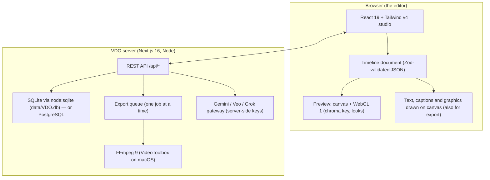

# VDO Studio — Product Presentation & Capability Reference

> A source document for product walkthroughs, slide decks and NotebookLM. Every capability below is checked against the code (October 2026). Features that work but don't yet do everything their name suggests are marked **Beta**, with what they really do.

---

## Contents

1. What VDO Studio is
2. Who it is for, and the business model
3. How it works (architecture)
4. The editor: timeline and editing
5. Subtitles, captions and text-based editing
6. Audio: clean-up, mixing, dubbing and beats
7. Transparent web avatars (the flagship)
8. Graphics, looks and effects
9. AI tools: Ready and Beta
10. Export
11. Accounts, plans, admin and referrals
12. Privacy: what stays on your computer and what doesn't
13. Keyboard shortcuts
14. Honest comparison
15. Presentation scripts
16. Roadmap

---

## 1. What VDO Studio is

**VDO Studio is a browser-based video editor for creators, built for India first.** You edit on a multi-track timeline in your browser while the heavy work (encoding, audio analysis) runs on the machine where VDO is installed, using FFmpeg. AI helpers built on Google Gemini (and optionally xAI Grok) do the slow jobs: subtitles, translation and dubbing, voiceovers, highlights, chapters, image and video generation.

**Tagline:** *Edit Reels, Shorts and YouTube videos with AI — in your browser.*

**What makes it different**

- **Word-by-word animated captions** in 21 languages including Hindi, Hinglish and 8 other Indian languages, with real word timings and one-click looks.
- **Transparent web avatars:** a green-screen or Veo clip becomes a see-through video for any website (WebM VP9 alpha + MOV HEVC alpha + embed code), one export for every browser.
- **Editing by transcript:** delete words or filler sounds ("um", "uh") and the video, subtitles and graphics cut and ripple with them.
- **One click, three formats:** the same project as YouTube 16:9, Shorts/Reels 9:16 and square 1:1.
- **Hindi ↔ English dubbing:** each line translated and spoken in a new voice, in sync, with the original turned down underneath.
- **Local-first editing:** your source files stay in your own storage; only what an AI feature needs is sent, when you click it.

---

## 2. Who it is for, and the business model

**Users:** YouTubers, Reels/Shorts creators, freelancers and small studios (primarily India: ₹ pricing, GST invoices, Razorpay, Hindi/Hinglish support), plus web teams who need transparent video avatars.

**Plans** (prices include 18% GST on invoices; AI credits refresh each billing period):

| Plan | Price | Trial | AI credits | Devices | Highlights |
|---|---|---|---|---|---|
| Free | ₹0 | – | 10 / month | 1 | 720p and 1080p export, core editing |
| Weekly Pro | ₹299 / week | 3 days | 60 | 2 | 4K60 export, full AI tools |
| Monthly Pro | ₹999 / month | 7 days | 250 | 2 | 4K60, transparent WebM export, brand kits |
| Annual Studio | ₹7,999 / year | 14 days | 3,500 | 4 | everything in Pro, best value |

- **Payments:** Razorpay (sandbox mode for testing), refunds and partial refunds from the admin panel, GST invoices.
- **Coupons:** percentage or fixed-amount (₹), first payment / first N cycles / every renewal, expiry dates, usage limits, bulk code generation.
- **Referral program:** a creator shares a link and earns a commission (default 20%) on referred purchases after a 14-day holding period, into a wallet; withdrawals to UPI or bank are approved by an admin (manual UTR or RazorpayX payouts).
- **Planned (not yet enforced in code):** AI credits being spent per AI use, per-plan export limits and a Free-plan watermark. See the roadmap.

---

## 3. How it works (architecture)



- **Projects** are JSON timeline documents saved to the user's workspace, with autosave (about 0.6 s after a change), up to 50 saved versions and crash recovery.
- **Accounts, billing and admin data** live in SQLite (`node:sqlite`, `data/VDO.db`), or PostgreSQL when `DATABASE_URL` is set.
- **Export** runs on the server with FFmpeg; the browser draws texts, captions and graphics as images so the export matches the preview exactly.
- **Platform notes:** VideoToolbox (fast HEVC and the HEVC-alpha MOV), the macOS `say` voices and Apple Vision background removal need the server to be a Mac. Everything else runs on any FFmpeg host.

---

## 4. The editor: timeline and editing

- **Multi-track timeline:** Video 1 (magnetic: clips stay back to back), overlay tracks for video, pictures, text and graphics, and sound tracks. Track reorder, lock, hide and mute.
- **Trimming:** Google Vids-style left/right trims with a live frame under the cursor; split (S), ripple delete, duplicate, copy/paste, copy and paste style, close all gaps.
- **Markers** (M) with notes and colours; clips snap to markers, clips and the playhead.
- **Clip controls:** position, scale, rotation, crop, flip, corner pin, opacity, 13 blend modes, shape masks (rectangle, rounded, circle, diamond, star, custom), speed 0.25×–4×, reverse, freeze frame, fades.
- **Keyframes** on 9 properties (up to 40 per clip, smooth or linear easing).
- **Motion tracking:** hand-written optical flow (pyramidal Lucas-Kanade with template matching) and a face finder, over the whole clip or a chosen time range; text, graphics or pictures follow the tracked point (position, scale, rotation).
- **Detach / re-attach audio** in one click (volume and fades kept).
- **Stabilise** (FFmpeg deshake) and **auto colour**.
- **Undo/redo** (100 steps), command palette (⌘K), 50 starter and broadcast templates plus your own saved templates.
- **Recording:** camera, screen, screen + camera, or voice, straight onto the timeline.
- **Media:** your uploads, a local folder (File System Access API), a meme and sound-effect library, stock video/photos from Pexels and Pixabay (API keys required).

---

## 5. Subtitles, captions and text-based editing

- **✦ Auto subtitles** (Gemini) in 21 languages: English, Hindi (Devanagari), Hinglish (Hindi in English letters), Bengali, Tamil, Telugu, Marathi, Gujarati, Kannada, Malayalam, Punjabi, Urdu, Arabic, Spanish, French, German, Portuguese, Russian, Indonesian, Japanese and Chinese, or "find it for me".
- **Word timings:** Gemini also returns when each word is said; captions keep them (without them, the highlight spreads evenly).
- **Word-by-word looks:** Pop, Bounce, Karaoke, Glow, Box or Plain. Choose a look before making subtitles and they arrive styled in one click. The preview and the export highlight the same word at the same moment.
- **😀 Add emojis:** one fitting emoji per caption from English and Hinglish keywords (paisa 💰, kamaal 🤩, fire 🔥 …), staying in sync.
- **Translate subtitles** into another language on a new track.
- **Edit by transcript:** select words, or "Remove all filler words" (only true hesitation sounds such as um, uh, er and hmm; never real words like "like" or "so"). The cut lands in the right place on every Video 1 clip it touches, accounting for trims and speed. Subtitles and graphics after the cut move back with it, and the cut words leave the subtitle text.
- **YouTube chapters:** every marker becomes a chapter. ✦ Gemini can suggest chapters from the subtitles; one click copies "0:00 Title" lines for the YouTube description and warns if YouTube's rules (start at 0:00, at least 3 chapters, each at least 10 s) aren't met.
- **SRT / VTT** download.
- **Beta:** "Offline sample" subtitles place sample lines for trying styles and timing; they don't recognise speech yet.

---

## 6. Audio: clean-up, mixing, dubbing and beats

- **Clean up the sound** per clip: Light (hiss, room noise), Strong (also hum and rumble), or **Studio voice**, a one-click fix for phone recordings. Studio voice removes rumble, hiss and noise, compresses and evens out the voice so quiet words come up, adds a little presence, and limits peaks. The preview plays the same processing as the export.
- **Smart Audio Mix** (dialogue ducking) with three priorities:
  - **Both** (default): voiceover 85%, video speech 60%.
  - **Voiceover first** or **Video first:** the other side ducks.

  It writes volume keyframes with smooth ramps (non-destructive, one-click reset). Speech is found with FFmpeg `silencedetect`.
- **Remove silences:** detect pauses on a clip (threshold, minimum pause, padding) and cut them.
- **Loudness levelling** (EBU R128, −16 LUFS) per clip.
- **✦ Translate audio (dubbing):** subtitles → translation → a Gemini voice per line, placed on a sound track at the time of the original line, with the original turned down to 20% underneath and optional translated subtitles. Hindi ↔ English and 20+ languages, up to 60 lines per run.
- **Text to speech:** ✦ Gemini voices (30 voices, with a speaking style you describe) or the Mac's own voices (free, offline).
- **♪ Beat markers:** finds the beat of a music clip (tempo and beat positions, computed on the server from the decoded sound) and drops a marker on every beat, every 2 beats or every bar. Cuts then snap to the music.

---

## 7. Transparent web avatars (the flagship)

Chrome, Edge, Firefox and Android need **WebM with VP9 alpha**; Safari and iPhone need **MOV with HEVC alpha**. VDO Studio handles both:

1. **Key colour picker** with a magnifier on the preview.
2. **Live chroma key** in WebGL (similarity, smoothness, spill suppression), matching the export.
3. **Website pack export:** WebM (VP9 `yuva420p`), MOV (HEVC alpha via Apple VideoToolbox), a poster image and copy-paste embed code, in one export (optionally plus a ProRes 4444 master).
4. **AI background removal** without a green screen (Apple Vision, on a Mac server).

```html
<video autoplay loop muted playsinline>
  <source src="avatar.mov" type='video/mp4; codecs="hvc1"'>
  <source src="avatar.webm" type="video/webm">
</video>
```

---

## 8. Graphics, looks and effects

- **Text:** presets (titles, lower thirds, news bars, captions), 5 system fonts plus your own brand fonts, outline, gradient, shadow styles, background box, letter spacing, 8 animations (fade, slide, rise, pop, zoom, bounce, blur, typewriter).
- **Broadcast and camera graphics:** lower thirds, breaking-news ticker, live bugs, camera viewfinder HUD, framing grids, plus 27 stickers and 400+ emoji. All are drawn live, follow motion tracking, and export exactly.
- **Looks:** 11 one-click looks (Vivid, Warm, Cool, Cinematic, B&W, Vintage, Fade, Night, Cyberpunk, Sepia, Emerald) with vignette, plus brightness, contrast, saturation and temperature.
- **My looks:** save any grade under a name and reuse it on any clip.
- **Effects:** glow, film grain, blur, pixelate, sharpen.
- **Transitions:** 18 (crossfade, dip to black/white, 4 slides, 2 pushes, 4 wipes, zoom in/out, circle open/close, spin).
- **Brand kit:** logo (or watermark badge), up to 8 colours and 12 fonts, intro/outro, several kits.
- **Thumbnail maker:** the frame at the playhead, made punchier, with a big outlined headline in your brand colours and an optional badge; 1280×720 for YouTube or 1080×1920 for a Shorts cover, saved as PNG or JPG.

---

## 9. AI tools: Ready and Beta

| Tool | Status | What it really does |
|---|---|---|
| Auto subtitles + word timings | Ready ✦ | Gemini transcription, 21 languages incl. Hinglish |
| Translate subtitles | Ready ✦ | Gemini translation onto a new track |
| Translate audio (dubbing) | Ready ✦ | Subtitles → translation → Gemini voice per line, original ducked |
| Highlights / viral clips | Ready ✦ | Gemini scores the transcript and proposes clips |
| YouTube chapters | Ready ✦ | Gemini chapters from the subtitles → markers |
| Text to speech | Ready ✦ | Gemini (30 voices) or Mac voices |
| Generate video / text to video / extend | Ready ✦ | Google Veo 3.1 (paid Gemini tier) |
| Generate image / background | Ready ✦ | Gemini image models; Grok pictures with an xAI key |
| Smart reframe | Ready | Finds the face in 5 frames and crops around it (in the browser) |
| Upscale / Enhance | Ready | Sharpening plus Lanczos enlarging when you export bigger (no AI model) |
| AI background removal | Ready | Apple Vision on a Mac server |
| Remove object | **Beta** | A movable cover box that blends nearby pixels, not AI inpainting |
| Voice clone | **Beta** | Gemini voices with a described style; no cloning of your own voice yet |
| AI avatar | **Beta** | A still presenter picture; talking avatars need a paid avatar service |
| B-roll / effects / replace sky | **Beta** | Still pictures from Gemini; not moving footage or automatic sky detection |
| Remove video noise | **Beta** | Opens Enhance (sharpening); a real video denoise filter is planned |
| Grok video | **Beta** | Placeholder output for now |
| YouTube upload | **Beta** | Simulated until YouTube sign-in is configured |
| Offline subtitles | **Beta** | Sample lines only |

✦ = sends the needed audio, frames or words to Google (or xAI for Grok), only when you click it. The price is shown before you click.

---

## 10. Export

- **15 formats:**
  - **Video:** MP4 (H.264, HEVC, AV1), WebM VP9, ProRes 422 HQ.
  - **See-through video:** WebM VP9 + alpha, MOV HEVC + alpha, the website pack, ProRes 4444.
  - **Pictures:** GIF, PNG, JPG.
  - **Sound:** MP3, M4A, WAV.
- **Social sizes:** YouTube 16:9 (1920×1080), Shorts/Reels/TikTok 9:16 (1080×1920), square 1:1, Instagram portrait 4:5; **All 3 sizes** queues 16:9 + 9:16 + 1:1 in one click.
- **Size estimate** before export; a background queue shows progress; quality and resolution choices.
- **Encoders:** H.264 MP4 uses libx264. VideoToolbox hardware encoding is used for HEVC and the HEVC-alpha MOV on macOS.

---

## 11. Accounts, plans, admin and referrals

- **Sign-in:** email + password (verification email), Google, or phone OTP.
- **Device limit** per plan, with session management.
- **Roles:** user, admin, super_admin. Plain admins manage regular users, coupons, bulk jobs, targeted campaigns and payout approvals. Super admins also handle refunds, payout disbursement, plan pricing, all-user broadcasts, roles, user deletion and system and referral settings.
- **Admin panel:**
  - **Dashboard:** revenue per currency net of refunds; live subscriptions per plan; **Growth**: MRR and ARR (paying plans priced per month, trials excluded), paying subscribers, 30-day churn, daily signups and paid payments for 30 days (charts with a table view), and the AI tools used most.
  - **Users and devices:** roles, suspend, password reset, per-user tool access, AI credits, sessions, and soft delete (financial records kept). Clicking a name opens a **user 360** panel: plan and subscription, payments and refunds, credit ledger, devices, referrals and wallet, and their audit trail.
  - **Plans, coupons, subscriptions and payments:** refunds and partial refunds; per-plan export limit and watermark; the GST invoice of any payment.
  - **CSV exports:** payments, refunds, payouts and users (UTF-8 for Excel; each download is audit-logged; no bank details).
  - **System health:** FFmpeg and encoders, database size, free disk, export queue, Gemini key, Razorpay mode, email provider, default-password and encryption-secret checks.
  - **Editor announcement:** a short info or warning note shown over the editor, set in Settings.
  - **Referrals and payouts:** state-checked approve → pay, with no double payouts.
  - **Notifications:** direct, campaigns with a recipient-count check, lifecycle reminders.
  - **Bulk jobs:** credits, device limits, broadcasts and similar, with retry of failures.
  - **Tool and feature flags, audit log** (searchable, paged), and **settings**: secrets are never shown or logged.
- **Security:** HTTP-only sessions, rate-limited login and signup, safe redirects after sign-in, an audit trail for every admin action. An admin still on the seeded password must change it before the admin panel (or any admin API) works; in production, a fresh install without `INITIAL_ADMIN_PASSWORD` gets a random one-time password instead of the default.

---

## 12. Privacy: what stays on your computer and what doesn't

- **Stays local:** your source files, timelines, edits, previews and exports (processed by the VDO server you run; on your own Mac, nothing leaves it).
- **Goes to Google (or xAI) only when you click a ✦ feature:** the sound of the clip for subtitles and dubbing, the words for translation and chapters, your prompt (and picture) for generation. Keys stay on the server and are never sent to the browser or saved in projects.
- **Account data** (email, plan, payments) is stored in the VDO database; card details are handled by Razorpay, never by VDO.

---

## 13. Keyboard shortcuts

| Keys | Action |
|---|---|
| Space · J / K / L | Play/pause · shuttle |
| ← / → (Shift: 1 s) | Step a frame (or move the selected clip) |
| ↑ / ↓ | Move the selected clip, or jump to the previous / next cut |
| Home / End | Start / end |
| S · Q / W | Split · trim to the playhead |
| Delete / Backspace | Delete (ripple on Video 1) |
| M | Add marker |
| B · T | Blank scene · title |
| D | Disable clip |
| [ / ] · + / − · ⇧Z | Previous / next cut · zoom · fit timeline |
| \ | Compare before/after |
| F | Focus |
| ⌘Z / ⌘⇧Z | Undo / redo |
| ⌘C / ⌘X / ⌘V · ⌘⌥C / ⌘⌥V | Copy/cut/paste · copy/paste style |
| ⌘D · ⌘A · ⌘S | Duplicate · select all · save |
| ⌘K · ? · Esc | Command palette · shortcuts · close |

---

## 14. Honest comparison

| | VDO Studio | CapCut | Canva | Descript | Premiere Pro |
|---|---|---|---|---|---|
| Runs in | Browser (+ your VDO server) | Desktop / web | Web | Desktop / web | Desktop |
| Word-by-word captions incl. Hinglish | ✅ | ✅ (no Hinglish) | ✅ | ✅ | Plug-ins |
| Edit by transcript | ✅ | Partial | ❌ | ✅ (best in class) | ✅ |
| Dubbing (Hindi ↔ English) | ✅ | ✅ | ✅ | ✅ | ❌ |
| Transparent web avatar export (WebM + MOV + embed) | ✅ one click | ❌ | ❌ | ❌ | Manual |
| Local-first source files | ✅ | Cloud sync | Cloud | Cloud | ✅ |
| ₹ pricing + GST invoices | ✅ | ✅ | ✅ | ❌ | ❌ |
| Talking AI avatars, object inpainting | Beta / planned | ✅ | ✅ | ✅ | ✅ |
| Collaboration / review links | Planned | ✅ | ✅ | ✅ | ✅ |

---

## 15. Presentation scripts

### 60-second pitch
> *"Creators in India post the same video to YouTube, Reels and Shorts, in Hindi and English, every week. Today that means three apps and hours of captioning. VDO Studio is one browser editor that does it: auto captions that pop word by word, in Hindi, Hinglish and 20 more languages; cut the 'ums' by deleting words in the transcript; dub Hindi to English with the original voice ducked underneath; and export 16:9, 9:16 and square with one click. Your source files stay on your own storage, and AI only sees what it needs when you click it. Plans start free and Pro is ₹999 a month."*

### 5-minute demo outline
1. **Import and trim (0:00–0:45):** a talking-head clip, the trim with the live frame, split, ripple.
2. **Captions (0:45–1:45):** Make subtitles in Hinglish with the "Pop" look; play the word-by-word highlight; add emojis.
3. **Transcript edit (1:45–2:30):** remove all filler words and watch the video, subtitles and graphics ripple.
4. **Audio (2:30–3:15):** Studio voice on a phone recording; Smart Mix with a voiceover; beat markers on music.
5. **Dubbing (3:15–4:00):** dub Hindi → English; the original stays underneath.
6. **Output (4:00–5:00):** thumbnail maker, YouTube chapters, All 3 sizes export, and the transparent-avatar website pack.

### NotebookLM prompts
- *"Make a lively two-host podcast explaining how VDO Studio helps Indian creators publish one video as YouTube, Reels and Shorts in Hindi and English, covering captions, transcript editing, dubbing and the transparent web avatar export. Be accurate about which AI tools are Beta."*
- *"Extract a 10-slide pitch deck: problem, product, demo flow, AI tools (Ready vs Beta), pricing in ₹, business model with referrals, privacy, competition, roadmap, ask. Include speaker notes."*

---

## 16. Roadmap

**Shipped recently:** word-timed captions with looks and emojis; transcript cuts that ripple correctly; Studio voice; All 3 sizes export; YouTube chapters; thumbnail maker; My looks; beat markers; real smart reframe, enhance and dubbing; honest Beta labels.

**Next:**
- AI credits spent per AI use, with per-plan limits and a Free-plan watermark.
- A revenue and growth dashboard; a single per-user view in admin; CSV and GST exports; a system health page; 2FA for super admins.
- Website polish: mobile menu, faster pages, honest copy and real product video.

**Later (needs paid model services or hosting):** talking avatars, AI object inpainting, voice cloning, collaboration and review links, cloud backup, compound clips, a keyframe graph editor, LUT (.cube) import.
