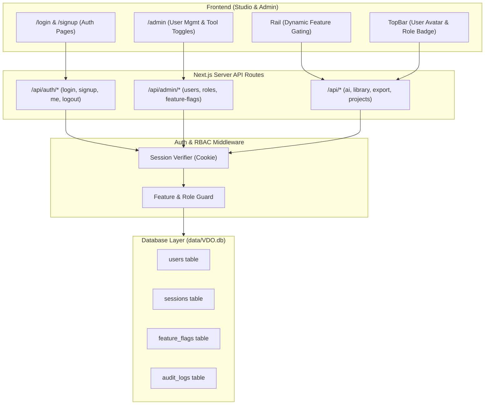

# Implementation Plan: Authentication, Role-Based Access Control (RBAC), and Admin Tool Customization

This document outlines the architecture and execution plan for adding User Authentication, a Relational Database, Role-Based Access Control (`super_admin`, `admin`, `user`), and an Administrative Panel for customizing tools and feature permissions (Library, Elements, Effects, AI Tools, etc.) in VDO.

---

## Goal Description

Currently, VDO is a single-tenant client-server video editor where projects and uploads are saved directly to the local filesystem without user identity or access restrictions.

The goal is to introduce:

1. **User Authentication (Login & Signup)**: Secure email/password registration and authentication with session management via HTTP-only secure cookies.
2. **Relational Database (`data/VDO.db`)**: A robust, zero-dependency embedded database using Node.js 24's native `node:sqlite` (with an architecture ready to hook into PostgreSQL via `DATABASE_URL` if needed).
3. **Role-Based Access Control (RBAC)**: Distinct permissions for `super_admin`, `admin`, and `user`.
4. **Admin Panel (`/admin`)**: A dedicated administration interface to manage users, roles, account statuses, and dynamically toggle tools/features (Library, Elements, Effects, AI Tools, Brand Kit, Templates, Audio, Subtitles, Export) globally or per role.
5. **Studio & API Permission Enforcement**: Dynamic UI gating in `Rail.tsx`, `Studio.tsx`, and `TopBar.tsx`, plus server-side route guards on protected API endpoints.



---

## User Review Required

> [!IMPORTANT]
> **Database Choice**: We recommend using Node.js 24's native built-in `node:sqlite` engine (`data/VDO.db`).
>
> - **Why?** Zero external binary/npm compilation dependencies (unlike `better-sqlite3` which requires C++ compilers), zero external Docker/Postgres daemon setup, instant execution, completely portable, and ACID compliant.
> - The database client abstraction will be modular so it can be swapped to PostgreSQL (`pg` / `DATABASE_URL`) with minimal friction whenever cloud deployment is needed.

> [!IMPORTANT]
> **Guest vs Mandatory Login**:
>
> - **Recommended Approach**: Allow a configurable mode. By default, unauthenticated users can access the studio in "Guest Mode" with baseline tools enabled (or prompted to log in), while authenticated users receive their specific role permissions and project association. Admin setting allows toggling **Mandatory Login** so guests are automatically redirected to `/login`.

> [!WARNING]
> **Super Admin Bootstrapping**:
>
> - On initial run, if no users exist in the database, the system will automatically seed an initial Super Admin account (or provide a one-time `/setup` or `.env` configuration: `INITIAL_ADMIN_EMAIL` and `INITIAL_ADMIN_PASSWORD`). Default seed credentials will be provided (e.g. `admin@VDO.local` / `Admin@12345`) and prompted to change on first login.

---

## Open Questions

> [!NOTE]
>
> 1. **Project Ownership**: When users log in, should existing local projects belong to all users, or should projects be linked to the specific `user_id` who created them?
>    _(Recommended: Link new projects to `user_id`, while keeping legacy or unauthenticated projects visible to all or claimed by the first admin)._
> 2. **Guest Access**: Should unauthenticated guests be allowed to try basic video editing tools before signing up, or should every visitor be forced to log in before seeing the studio?

---

## Proposed Changes

### Component 1: Database Architecture (`lib/db/`)

We will create a lightweight, high-performance database service using Node 24 `node:sqlite` with automatic migrations and thread-safe operations.

#### [NEW] `lib/db/index.ts`

- Manages the SQLite database connection (`data/VDO.db`).
- WAL (Write-Ahead Logging) enabled for maximum concurrent read/write throughput.
- Foreign key constraints enabled.

#### [NEW] `lib/db/schema.ts`

Database tables:

1. `users`:
   - `id`: TEXT PRIMARY KEY
   - `email`: TEXT UNIQUE NOT NULL
   - `name`: TEXT NOT NULL
   - `password_hash`: TEXT NOT NULL
   - `password_salt`: TEXT NOT NULL
   - `role`: TEXT NOT NULL DEFAULT 'user' (`super_admin` | `admin` | `user`)
   - `status`: TEXT NOT NULL DEFAULT 'active' (`active` | `suspended`)
   - `created_at`: INTEGER NOT NULL
   - `updated_at`: INTEGER NOT NULL
   - `last_login_at`: INTEGER
2. `sessions`:
   - `id`: TEXT PRIMARY KEY
   - `user_id`: TEXT NOT NULL REFERENCES users(id) ON DELETE CASCADE
   - `token`: TEXT UNIQUE NOT NULL
   - `expires_at`: INTEGER NOT NULL
   - `created_at`: INTEGER NOT NULL
3. `feature_flags`:
   - `tool_id`: TEXT PRIMARY KEY (e.g. `'library'`, `'elements'`, `'effects'`, `'ai'`, `'brand'`, `'templates'`, `'audio'`, `'subtitles'`, `'transitions'`, `'export'`)
   - `title`: TEXT NOT NULL
   - `description`: TEXT NOT NULL
   - `enabled_global`: INTEGER NOT NULL DEFAULT 1
   - `allowed_roles`: TEXT NOT NULL (JSON array of strings: `["super_admin", "admin", "user"]`)
   - `updated_at`: INTEGER NOT NULL
   - `updated_by`: TEXT
4. `audit_logs`:
   - `id`: TEXT PRIMARY KEY
   - `actor_id`: TEXT REFERENCES users(id)
   - `action`: TEXT NOT NULL
   - `target`: TEXT
   - `details`: TEXT
   - `created_at`: INTEGER NOT NULL

#### [NEW] `lib/db/seed.ts`

- Initializes tables on first boot.
- Seeds default `feature_flags` for all current studio tools.
- Seeds default `super_admin` account if no super admin exists.

---

### Component 2: Authentication & Security (`lib/auth/`)

#### [NEW] `lib/auth/passwords.ts`

- Uses Node.js native `crypto.scrypt` + random salt (64 bytes) for cryptographically secure, NIST-compliant password hashing and verification without external C++ binary dependencies.

#### [NEW] `lib/auth/session.ts`

- Creates, resolves, and invalidates session tokens.
- Reads session cookie (`VDO_session`) from incoming requests.
- Computes user identity and current active permissions.

#### [NEW] `lib/auth/permissions.ts`

- Role hierarchy helper (`super_admin` > `admin` > `user`).
- Function `canUserAccessTool(user: UserSession | null, toolId: string): boolean`.
- Function `isUserAdmin(user: UserSession | null): boolean`.

---

### Component 3: Auth & Admin API Routes (`app/api/`)

#### [NEW] `app/api/auth/login/route.ts`

- POST: Validates email & password, sets secure HTTP-only cookie, returns user object and permissions.

#### [NEW] `app/api/auth/signup/route.ts`

- POST: Validates input, checks duplicate email, hashes password, inserts user, sets session cookie.

#### [NEW] `app/api/auth/logout/route.ts`

- POST: Clears cookie and deletes session from DB.

#### [NEW] `app/api/auth/me/route.ts`

- GET: Returns current user, role, and authorized tool permissions for client-side state.

#### [NEW] `app/api/admin/users/route.ts`

- GET (admin only): Lists users with search, role filter, pagination.
- POST (admin only): Create new user directly from admin panel.

#### [NEW] `app/api/admin/users/[id]/route.ts`

- PATCH (admin only): Update user role, status (`active` / `suspended`), or trigger password reset.
- DELETE (super_admin only): Delete user.

#### [NEW] `app/api/admin/features/route.ts`

- GET: Returns all feature flags and role configurations.
- PATCH (admin only): Update global switch or allowed roles for any tool (e.g. restrict `ai` to `admin`, disable `library` globally).

---

### Component 4: Auth UI Pages (`app/login/`, `app/signup/`)

#### [NEW] `app/login/page.tsx`

- Sleek, premium dark/light mode login UI styled to match VDO's design tokens.
- Fields: Email, Password, Remember Me, Sign In button, Link to Sign Up.
- Error callouts (invalid credentials, suspended account).

#### [NEW] `app/signup/page.tsx`

- Registration UI: Full Name, Email, Password, Confirm Password, Create Account button.

---

### Component 5: Admin Panel (`app/admin/`)

#### [NEW] `app/admin/layout.tsx`

- Authenticated admin layout with navigation sidebar:
  - Overview / Dashboard
  - User Management
  - Studio Tools & Features Customization
  - Audit Logs
  - Back to Studio button
- Middleware guard: Redirects non-admins to `/` or `/login`.

#### [NEW] `app/admin/page.tsx`

- Admin Dashboard with metrics:
  - Total users, active users, super admins/admins
  - Feature access matrix summary
  - Quick action to toggle tools

#### [NEW] `app/admin/users/page.tsx`

- Users management table:
  - Search by name or email
  - Role dropdown selector (`super_admin`, `admin`, `user`)
  - Status toggle (`active` / `suspended`)
  - Add User modal

#### [NEW] `app/admin/features/page.tsx`

- Interactive Tool & Feature Customization Matrix:
  - Cards / rows for each studio feature:
    - **Library** (Meme Catalog, Web dynamic search)
    - **Elements** (Shapes, Badges, Overlays)
    - **Effects** (Visual filters, Color LUTs)
    - **AI Tools** (Gemini script, Voiceover, Veo generation)
    - **Brand Kit** (Logo watermark, Custom Intro/Outro)
    - **Audio** (Audio tracks, SFX)
    - **Subtitles** (Auto speech captions)
    - **Transitions** (Scene transitions)
    - **Templates** (Project presets)
    - **High-Res Export** (4K & Ultra quality export presets)
  - Controls per tool:
    - **Global Toggle Switch** (Enable / Disable completely)
    - **Role Checkboxes** (`Super Admin`, `Admin`, `User`)
  - Instant live update with toast feedback.

---

### Component 6: Studio Integration & Permission Gating

#### [MODIFY] `components/studio/Rail.tsx`

- Pass user feature permissions (`userFeatures: Record<PanelId, boolean>`).
- If a tool is disabled for the user's role:
  - Either hide it from the Rail or display a subtle lock badge with tooltip: `"Disabled by Administrator"`.

#### [MODIFY] `components/studio/TopBar.tsx`

- Add User Profile Button on the right header:
  - Shows Avatar/Initials and Role Badge (e.g. `SUPER ADMIN`, `ADMIN`, `USER`).
  - Dropdown menu:
    - User name & email
    - Role badge
    - Link to Admin Panel (if admin or super_admin)
    - Sign In / Sign Up buttons (if guest)
    - Sign Out button

#### [MODIFY] `components/studio/Studio.tsx`

- Integrate `useAuth` hook or server-provided session context.
- Prevent switching to disabled panels via hotkeys or programmatic selection.

---

## Verification Plan

### Automated Tests

1. **Database & Schema Tests**:
   - `tests/unit/db.test.ts`: Verify SQLite table creation, WAL mode, foreign keys, user insertion, unique constraints.
2. **Password & Auth Tests**:
   - `tests/unit/auth.test.ts`: Verify `scrypt` hashing, salt uniqueness, password verification, session creation and token expiration.
3. **RBAC & Feature Flags Tests**:
   - `tests/unit/rbac.test.ts`: Verify role hierarchies, permission resolution, tool access calculation, and super admin overrides.
4. **Full Unit Test Suite**:
   ```bash
   npm run test:unit
   ```
5. **Typecheck & Lint**:
   ```bash
   npm run typecheck
   npm run lint
   ```

### Manual Verification

1. **Initial Setup & Seeding**:
   - Start app, verify `data/VDO.db` is automatically created with tables and seeded super admin account.
2. **User Authentication Flow**:
   - Open `/signup`, register a new user `editor@test.com`.
   - Verify session cookie is set and user appears in Studio TopBar with `USER` badge.
   - Click Sign Out, verify session clears and returns to guest state.
   - Open `/login`, sign in with `admin@VDO.local`, verify redirect and `SUPER ADMIN` badge.
3. **Admin Panel Features**:
   - Navigate to `/admin`.
   - In Users Management: Change `editor@test.com`'s role from `user` to `admin`, suspend an account, test search.
   - In Features Customization:
     - Toggle off `AI Tools` for `user` role.
     - Toggle off `Library` globally.
   - Open Studio as `editor@test.com`: Verify Library and AI Tools are disabled/locked according to the matrix.
   - Re-enable in Admin Panel: Verify Studio immediately reflects the updated permissions.
